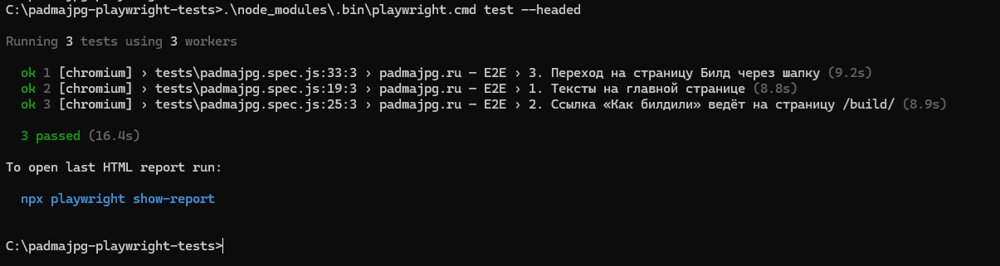

# Playwright-тесты для padmajpg.ru

E2E-тесты на Playwright для сайта [padmajpg.ru](https://padmajpg.ru).

## Что проверяют тесты

1. **Тексты на главной странице** — наличие заголовка «Войти и выйти» и двух фирменных фраз («Черрипикнуть в релиз», «работает на моей машине»).
2. **Интерактивные элементы** — ссылка «Как билдили →» видима, кликабельна, ведёт на `/build/`.
3. **Навигация** — переход на страницу «Билд» через меню в шапке, проверка URL и заголовка на новой странице.

Перед каждым тестом закрывается попап-заглушка `#puttyPopup` (по Escape), иначе он перехватывает клики.

## Установка

Две отдельные команды по очереди (не объединять через `+`):

```
npm init -y
npm install -D @playwright/test
```

Установка браузеров. Дефолтный CDN Playwright из РФ часто рвётся с `ECONNRESET`, поэтому используем зеркало npmmirror:

```
set PLAYWRIGHT_DOWNLOAD_HOST=https://cdn.npmmirror.com/binaries/playwright
npx playwright install chromium
```

Если это зеркало моргнёт — парное:

```
set PLAYWRIGHT_DOWNLOAD_HOST=https://registry.npmmirror.com/-/binary/playwright
npx playwright install chromium
```

**Про `ECONNRESET`:** промежуточные обрывы Playwright переживает сам (до 5 ретраев на файл). Установка прошла, если по каждому компоненту видишь `downloaded to ...`. Если все попытки рвутся и в конце `Failed to install browsers`:

```
rd /s /q "%LOCALAPPDATA%\ms-playwright"
set PLAYWRIGHT_DOWNLOAD_HOST=https://cdn.npmmirror.com/binaries/playwright
npx playwright install chromium
```

## Настройки

В `playwright.config.js` критичны три параметра:

- `timeout: 60_000` — сайт грузится медленно, 60 секунд с запасом.
- `ignoreHTTPSErrors: true` — если антивирус MITM-ит HTTPS, Chromium рвёт соединение на сертификате.
- `channel: 'chrome'` — запускает системный Google Chrome вместо скачанного Chromium. Без этой строки тесты падают с `timeout while setting up "page"`.

## Запуск

```
.\node_modules\.bin\playwright.cmd test --headed
```

**Через `npx playwright test` не запускай** — висит на резолюции пакета. Только прямой бинарник.

Ожидаемый результат:

```
Running 3 tests using 3 workers

  ✓  1. Тексты на главной странице (4.1s)
  ✓  2. Ссылка «Как билдили» ведёт на страницу /build/ (5.0s)
  ✓  3. Переход на страницу Билд через шапку (5.0s)

  3 passed (19.5s)
```

## Отчёт

Запускать **после** `test`, не до. Иначе `show-report` займёт терминал, и ты не увидишь вывод с `3 passed`.

```
.\node_modules\.bin\playwright.cmd show-report
```

Playwright поднимает локальный сервер и автоматически открывает браузер с HTML-отчётом. В консоли увидишь:

```
Serving HTML report at http://localhost:9323. Press Ctrl+C to quit.
```

**Важно:** `show-report` блокирует терминал — работает как локальный сервер, пока не нажмёшь `Ctrl+C`. Если окно нужно для других команд — открой **второе** окно Node.js command prompt для отчёта, а первое оставь для тестов.

В отчёте: список прогонов, статус каждого теста, время. Для упавших — вкладка **Trace** с пошаговым воспроизведением и подсветкой элементов.

Закрыть отчёт и вернуть терминал: **`Ctrl+C`**.

## Результат прогона



## Известные ограничения

- AI-виджет на сайте (`#aiInput`) существует, но скрыт. Триггер открытия не найден в статичной разметке — вероятно, виджет управляется внешним скриптом или открывается по нестандартному событию. В тестах не используется; вместо него тест 2 проверяет кликабельную ссылку «Как билдили →», которая ведёт на ту же страницу `/build/`.